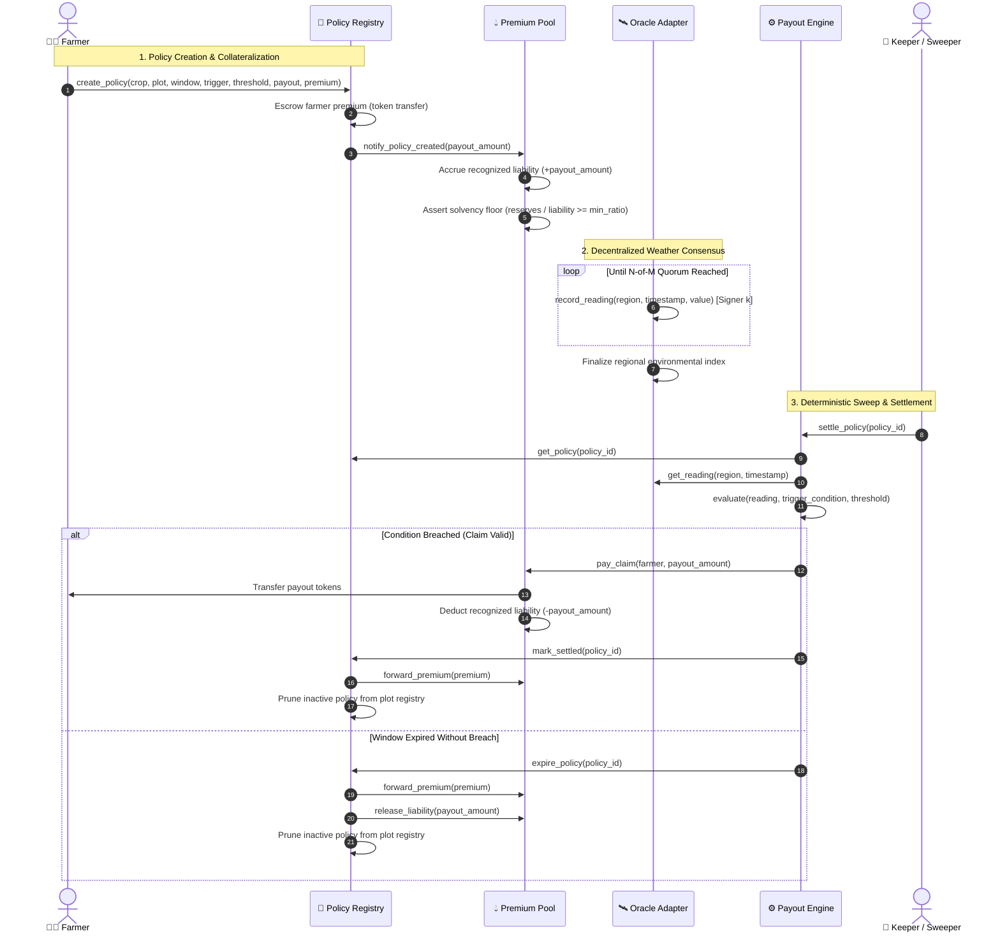

# AgriShield-Networks

[](https://github.com/AgroShield/AgriShield-Networks/releases/download/v1.0.0/agrishield-demo.mp4)
[](https://github.com/AgroShield/AgriShield-Networks/actions)
[](#live-deployment)
[](#interactive-api-documentation)
[](LICENSE)

AgriShield is a production-grade, open-source Stellar/Soroban parametric micro-insurance platform that
automatically protects smallholder farmers against climatic risks. When decentralized, threshold-verified
oracles record severe environmental observations (drought, frost, excess rainfall, heatwaves), the platform
triggers instant, deterministic payouts directly to farmers' Stellar wallets—eliminating claims friction,
assessment bias, and multi-week processing delays.

Pre-1.0, and deployed to testnet. See [Live deployment](#live-deployment)
for contract strkeys, verification transactions, and live web consoles.

| | |
| --- | --- |
| Console | **https://frontend-eight-delta-o0pj7gck3j.vercel.app** |
| API | **https://agrishield-backend-phi.vercel.app** — live, Fastify + Swagger + Prometheus |
| Network | Stellar testnet & Local Standalone Sandbox |
| Contracts | 4 deployed, wired, upgradeable and initialized — [proof](#live-deployment) |
| Tests | 290 contracts · 101 backend · 39 frontend (430 total) |
| Demo | **▶ [2-minute walkthrough](https://github.com/AgroShield/AgriShield-Networks/releases/download/v1.0.0/agrishield-demo.mp4)** — 1080p, 10.5 MB, narrated |

---

## Architecture & Lifecycle Sequence



---

## Core Capabilities & Mechanisms

### 1. Multi-Directional Parametric Trigger Engine

Unlike simple unidirectional models that only handle rainfall deficits, AgriShield models both deficit and excess hazards via `TriggerCondition`:

- **`BelowOrEqual` (Deficit Hazards):** Triggers when the verified index falls at or below threshold. Used for drought (soil moisture index), cold snaps, and sub-zero frost kill temperatures.
- **`AboveOrEqual` (Excess Hazards):** Triggers when the verified index rises at or above threshold. Used for river flood surges, extreme precipitation millimeter accumulations, and crop-wilting heatwaves.
- **Bounded Window Protection:** Readings are only eligible within `[coverage_start, coverage_end)`. Pre-existing conditions or post-harvest weather events cannot trigger payouts.
- **Earliest Breach Priority:** Payout entitlement is determined by the earliest valid observation, shielding farmers from post-breach weather rebounds.

### 2. Multi-Signer Threshold Weather Oracle

- **Consensus Quorum:** Observations only finalize once a configurable $K$-of-$N$ threshold of distinct authorized signing keys submit matching `(region, timestamp, index_value)` tuples.
- **Vote Split Mitigation:** Conflicting values for the same regional timestamp are rejected rather than forming duplicate state branches.
- **Automatic Pending Reading Pruning:** Stale, unfinalized observation requests are garbage collected to prevent unbound storage inflation.

### 3. Capital Solvency Floor & Auto-Liability Accrual

- **Strict Solvency Ratio:** The liquidity pool enforces an unyielding capital adequacy floor (default **120%** of recognized liabilities). Admin surplus withdrawals revert if they would breach this floor.
- **Real-Time Liability Accounting:** Policy creation atomically increases recognized liabilities on the pool; cancellation or expiration immediately releases recognized liability.
- **Escrow-to-Pool Premium Sweeps:** On policy settlement or expiration, escrowed premiums are automatically forwarded to the pool, replenishing risk reserves.
- **Emergency Plot Pruning:** Concluded policies are pruned from the plot index, preventing plot lockout while bounding storage iteration costs.

### 4. Enterprise Security & Web3 Governance

- **Two-Step Admin Transfers:** Critical governance role transfers across all 4 contracts use a nomination-and-acceptance pattern (`nominate_admin` followed by `accept_admin`), eliminating accidental admin burn.
- **Emergency Circuit Breakers:** Granular `pause()` and `resume()` switches protect user assets if an unexpected anomaly occurs, while preserving read-only queries and inspection.
- **Live WASM Upgradeability:** Standardized `upgrade(new_wasm_hash)` entrypoints allow bug fixes and algorithm improvements without contract address migrations or data re-indexing.

---

## Backend Infrastructure & Keeper Architecture

The backend (`backend/`) is a high-performance Fastify TypeScript service acting as both an API gateway and an automated autonomous keeper:

- **Atomic Soroban Sequence Mutex:** A thread-safe transaction sequence mutex eliminates race conditions and 400 Bad Sequence collision errors during concurrent settlement submissions.
- **Resilient Polling & Exponential Backoff:** The keeper gracefully recovers from transient RPC network glitches and automatically decodes Soroban XDR error streams.
- **Persistent Cursor Tracking:** The keeper persists sweep state across process restarts, ensuring large policy sets are processed without re-scanning from index 0.
- **LRU In-Memory Policy Cache:** Caches immutable policy terms to eliminate redundant RPC roundtrips.
- **Hardened Edge Security:** Configurable CORS allowed origins, strict HTTP security headers, and sliding-window IP rate limiting.
- **Interactive Swagger Documentation:** Built-in OpenAPI 3.0 specification served at `/docs` (interactive UI) and `/docs/json`.
- **Prometheus Observability:** Operational telemetry exposed at `/metrics` (request latency, keeper sweeps, error counters).

---

## Modern Frontend Web3 Console

The operator and farmer console (`frontend/`) is a React 19 + TypeScript SPA styled with semantic CSS custom properties:

- **Stellar Wallets Kit:** Seamless connection to browser wallet extensions (Freighter) with instant fallback to a simulated local Web3 demo account.
- **Farmer Self-Service Policy Creator:** Interactive modal to configure crop type, plot identifier, coverage window, trigger condition (`BelowOrEqual` vs `AboveOrEqual`), and payout guarantees with real-time risk multiple calculations.
- **Direct Wallet Signing:** Farmers and operators can sign policy cancellations and manual settlements directly using their connected Stellar key.
- **Liquidity Pool & Solvency Dashboard:** Real-time visibility into total pool reserves, recognized liabilities, and solvency health status.
- **Oracle Co-Signer Portal:** Threshold signers can view pending observations and co-sign regional weather readings with one click.
- **Accessible UI & Toast Alerts:** Non-intrusive auto-dismissing toast notifications and native Light/Dark theme switching with persistent local storage.

---

## Live Deployment

Deployed and exercised on **Stellar testnet**:

| Contract | Strkey Address | Explorer |
| --- | --- | --- |
| `policy-registry` | `CDBHGAUHDNPATEWKI4QKVEDUFY4Z3KNM3U5Q24SN5O4WNWOCJDASQ6D6` | [View on StellarExpert](https://stellar.expert/explorer/testnet/contract/CDBHGAUHDNPATEWKI4QKVEDUFY4Z3KNM3U5Q24SN5O4WNWOCJDASQ6D6) |
| `payout-engine` | `CACW6OLOLGQZ6HK6F2CSAYJ4JFNEBSPDAYS7OVMYPXIBAYHGDLZTWSBB` | [View on StellarExpert](https://stellar.expert/explorer/testnet/contract/CACW6OLOLGQZ6HK6F2CSAYJ4JFNEBSPDAYS7OVMYPXIBAYHGDLZTWSBB) |
| `premium-pool` | `CD6AE6HF3C666LV6VCMILITL5FQ5AAZUU6ID2PZTOIE3GTNBOHYTVGZG` | [View on StellarExpert](https://stellar.expert/explorer/testnet/contract/CD6AE6HF3C666LV6VCMILITL5FQ5AAZUU6ID2PZTOIE3GTNBOHYTVGZG) |
| `oracle-adapter` | `CBAPAFWLOPF25VVUQOTIWUKM2EQF5B5PAFI2YZLMLK5QUVPMR3NK526S` | [View on StellarExpert](https://stellar.expert/explorer/testnet/contract/CBAPAFWLOPF25VVUQOTIWUKM2EQF5B5PAFI2YZLMLK5QUVPMR3NK526S) |
| `AGRI` Token | `CCVYQCIK6BTLOWMSQJU2A3MJ4K4MTQ2TTH2RIF5JXO2ML7ZEI36RNMA7` | [View on StellarExpert](https://stellar.expert/explorer/testnet/contract/CCVYQCIK6BTLOWMSQJU2A3MJ4K4MTQ2TTH2RIF5JXO2ML7ZEI36RNMA7) |

---

## Quickstart & Local Development

### Option 1: Full-Stack Docker Compose (Recommended)

Run the backend, frontend, and local standalone Soroban RPC node with a single command:

```bash
docker compose up --build
```

- **Frontend Console:** `http://localhost:8080`
- **Backend API & Swagger:** `http://localhost:3000/docs`
- **Health Diagnostics:** `http://localhost:3000/health`
- **Prometheus Metrics:** `http://localhost:3000/metrics`

### Option 2: Automated Local Devnet Sandbox

To spin up a local standalone test environment, deploy the 4 contracts, wire authorizations, seed reserve liquidity, and mint test policies:

**On Linux / macOS:**
```bash
./scripts/setup-local-sandbox.sh --start-docker
```

**On Windows (PowerShell):**
```powershell
.\scripts\setup-local-sandbox.ps1 -StartDocker
```

The script automatically generates `backend/.env` and `frontend/.env` populated with the deployed contract IDs.

### Option 3: Manual Step-by-Step Setup

```bash
# 1. Clone repository
git clone https://github.com/AgroShield/AgriShield-Networks.git
cd AgriShield-Networks

# 2. Build and test smart contracts
cargo test --workspace

# 3. Build contracts for wasm32v1-none
cargo build --target wasm32v1-none --release

# 4. Start backend
cd backend
npm install
npm run dev

# 5. Start frontend
cd ../frontend
npm install
npm run dev
```

---

## Interactive API Documentation

When the backend is running, navigate to:

- **Swagger UI:** `http://localhost:3000/docs`
- **OpenAPI 3.0 Schema:** `http://localhost:3000/docs/json`

### Key Endpoints:

| Method | Path | Description |
| --- | --- | --- |
| `GET` | `/health` | Live diagnostic health, ledger status, and contract wiring checks |
| `GET` | `/policies` | Paginated search of policies filtered by farmer or region |
| `GET` | `/policies/:id` | Full policy term details and status |
| `GET` | `/policies/:id/preview` | Deterministic simulation preview of settlement payout |
| `POST` | `/settlements/:id` | Keeper settlement submission with optional API key auth |
| `GET` | `/keeper/status` | Current keeper sweep cursor and recent execution log |
| `GET` | `/metrics` | Prometheus metrics scrape target |

---

## Verification & Testing Suite

All packages are strictly tested with 100% deterministic test runners:

```bash
# Smart contract unit, property, and fee tests (290 tests)
cargo test --workspace

# Backend API, gateway mutex, cache, and keeper tests (101 tests)
cd backend && npm test

# Frontend wallet adapter, UI panels, and modal tests (39 tests)
cd frontend && npm test
```

---

## Contributing & Security

- **Contributing Guide:** See [CONTRIBUTING.md](CONTRIBUTING.md) for branch guidelines, conventional commits, and PR requirements.
- **Architecture Details:** See [docs/ARCHITECTURE.md](docs/ARCHITECTURE.md) for contract state machines, storage schemas, and gas optimizations.
- **Security Policy:** Report vulnerabilities responsibly via [SECURITY.md](SECURITY.md).

---

## License

This project is licensed under the [MIT License](LICENSE).
